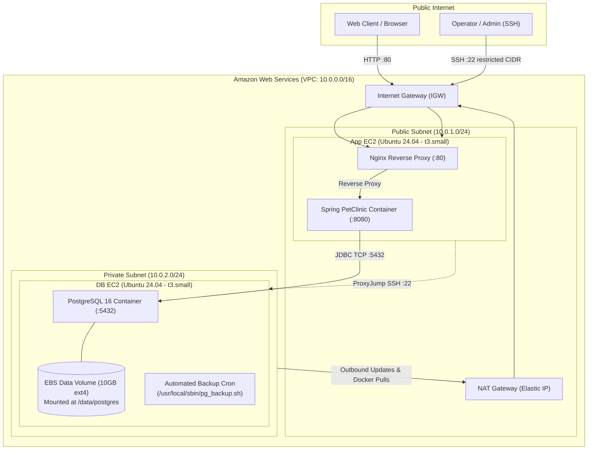

# Barq-Task01: Terraform & Ansible AWS Deployment

The stack utilizes **Terraform** for infrastructure provisioning (VPC, Subnets, Gateways, Security Groups, EC2 instances, EBS volumes) and **Ansible** for automated OS configuration, Docker runtime setup, containerized services deployment, and scheduled database backups.

---

## Documentation Index

| Document | Focus & Description |
| :--- | :--- |
| [`docs/TERRAFORM_INFRASTRUCTURE.md`](docs/TERRAFORM_INFRASTRUCTURE.md) | Terraform module architecture, VPC networking, security groups, and dynamic inventory generation. |
| [`docs/ANSIBLE_CONFIGURATION.md`](docs/ANSIBLE_CONFIGURATION.md) | Ansible role structure, playbook execution sequence, Vault setup, and disaster recovery. |
| [`docs/APPLICATION_AND_CONTAINERS.md`](docs/APPLICATION_AND_CONTAINERS.md) | Spring PetClinic upstream codebase, Dockerfile build specs, Nginx reverse proxy, and Compose templates. |

---

## Architecture Overview




## Prerequisites

Before running the deployment, ensure your local workstation has the following tools installed and configured:

### 1. Required Local Tools
| Tool | Minimum Version | Installation / Verification |
| :--- | :---: | :--- |
| **AWS CLI** | `v2.x` | `aws --version` |
| **Terraform** | `>= 1.5.0` | `terraform -version` |
| **Ansible** | `>= 2.15.0` | `ansible --version` |
| **Python** | `>= 3.10` | `python3 --version` |
| **OpenSSH** | Standard | `ssh -V` |
| **curl** | Standard | `curl --version` |

### 2. AWS Credentials Configuration
Ensure your AWS credentials are configured with permissions to manage EC2, VPC, Subnets, Route Tables, Internet Gateways, NAT Gateways, Elastic IPs, and EBS Volumes:

```bash
aws configure
# Enter:
# AWS Access Key ID: <YOUR_ACCESS_KEY>
# AWS Secret Access Key: <YOUR_SECRET_KEY>
# Default region name: us-east-1
# Default output format: json
```

Verify authentication:
```bash
aws sts get-caller-identity
```

---

## Ansible Vault Setup

Database credentials are encrypted using Ansible Vault:
- Encrypted secrets file: [`Ansible/group_vars/all/vault.yml`](file:///home/devops/barq/Barq-Task01-Terraform-Ansible/Ansible/group_vars/all/vault.yml)
- Variable mappings: [`Ansible/group_vars/all/vars.yml`](file:///home/devops/barq/Barq-Task01-Terraform-Ansible/Ansible/group_vars/all/vars.yml)
- Example template: [`Ansible/vault/vault.example.yml`](file:///home/devops/barq/Barq-Task01-Terraform-Ansible/Ansible/vault/vault.example.yml)

### Create the Vault Password File
Create a password file at `Ansible/vault/.vault.txt` (this file is ignored by Git):

```bash
echo "barq-task01-vault-secret" > Ansible/vault/.vault.txt
chmod 600 Ansible/vault/.vault.txt
```

> [!NOTE]
> [`Ansible/ansible.cfg`](file:///home/devops/barq/Barq-Task01-Terraform-Ansible/Ansible/ansible.cfg) is pre-configured with `vault_password_file = ./vault/.vault.txt`. Ansible automatically decrypts the vault during playbook execution without requiring interactive prompts.

To view or edit the encrypted secrets:
```bash
cd Ansible
ansible-vault view group_vars/all/vault.yml
ansible-vault edit group_vars/all/vault.yml
```

---

## Automated Deployment (Recommended)

The repository provides an end-to-end automated deployment script [`deploy.sh`](file:///home/devops/barq/Barq-Task01-Terraform-Ansible/deploy.sh).

### What `deploy.sh` Automates:
1. **Prerequisite Check**: Validates `terraform` and `ansible-playbook` CLI availability.
2. **SSH Key Management**: Verifies `~/.ssh/barq-task01` exists; if not, automatically generates an `ed25519` keypair.
3. **Configuration & IP Detection**: Ensures `Terraform/terraform.tfvars` exists (copies `terraform.tfvars.example` if missing), detects your current public IPv4 address, and generates `Terraform/terraform.auto.tfvars`.
4. **Terraform Apply**: Provisions VPC, NAT Gateway, Security Groups, EC2 instances, and EBS volume cleanly using the tfvars file.
5. **Inventory Generation**: Terraform automatically writes `Ansible/inventory/hosts.ini` with private IPs and SSH ProxyCommand.
6. **SSH Readiness Loop**: Polls the App instance over SSH until cloud-init finishes and the host is ready.
7. **Ansible Execution**: Installs required Ansible collections (`community.docker`, `community.general`, `ansible.posix`) and runs [`site.yml`](file:///home/devops/barq/Barq-Task01-Terraform-Ansible/Ansible/site.yml).

### Running the Script:

Before running, you can optionally create and customize `Terraform/terraform.tfvars`:
```bash
cp Terraform/terraform.tfvars.example Terraform/terraform.tfvars
# (Optional: customize aws_region, app_instance_type, or db_volume_gb)
```

Then execute the deployment:
```bash
chmod +x deploy.sh
./deploy.sh
```

*(Optional)* Override the SSH key path or allowed IP on the command line:
```bash
SSH_KEY="$HOME/.ssh/custom_key" SSH_ALLOWED_IP="198.51.100.25" ./deploy.sh
```


---

## Manual Deployment Steps

If you prefer executing each step manually:

### Step 1: Prepare SSH Key
```bash
KEY="$HOME/.ssh/barq-task01"
if [ ! -f "$KEY" ]; then
  ssh-keygen -t ed25519 -N "" -f "$KEY" -C "barq-task"
fi
```

### Step 2: Configure and Provision Infrastructure with Terraform
```bash
cd Terraform

# Copy the example variables file
cp terraform.tfvars.example terraform.tfvars

# Detect your current public IP
MY_IP=$(curl -s https://checkip.amazonaws.com | tr -d '[:space:]')
```

Edit `terraform.tfvars` with your operator IP, SSH key paths, and desired region/instance sizing:
```hcl
project_name      = "barq-task"
aws_region        = "us-east-1"
ssh_allowed_cidr  = "YOUR_PUBLIC_IP/32"       # e.g., "${MY_IP}/32"
public_key_path   = "~/.ssh/barq-task01.pub"
private_key_path  = "~/.ssh/barq-task01"
app_instance_type = "t3.small"
db_instance_type  = "t3.small"
db_volume_gb      = 10
```

Initialize and apply Terraform (Terraform automatically loads `terraform.tfvars` without requiring `-var` flags):
```bash
terraform init
terraform apply

# View generated outputs
terraform output
cd ..
```


Terraform automatically writes the dynamic Ansible inventory to `Ansible/inventory/hosts.ini` containing:
- `app01` public and private IP
- `db01` private IP with `ProxyCommand` configured through `app01`

### Step 3: Install Ansible Collections
```bash
cd Ansible
ansible-galaxy collection install -r requirements.yml
```

### Step 4: Execute the Ansible Playbook
```bash
ansible-playbook site.yml
cd ..
```

---

## Verification & Testing

### 1. Web Application Access
Once the deployment finishes, open your browser or use `curl`:
```bash
# Retrieve App IP
APP_IP=$(cd Terraform && terraform output -raw app_public_ip)

# Test HTTP access (Spring PetClinic home page)
curl -sI "http://${APP_IP}/"

# Test Healthcheck endpoint
curl -s "http://${APP_IP}/health"
# Expected response: healthy
```

### 2. Direct SSH to App Server
```bash
ssh -i ~/.ssh/barq-task01 ubuntu@"${APP_IP}"
```

### 3. SSH into Database Server via Jump Host
The DB instance is inside a private subnet and accessible via the App server:
```bash
# Get DB Private IP
DB_IP=$(cd Terraform && terraform output -raw db_private_ip)

# Option A: Connect using SSH ProxyJump (-J)
ssh -i ~/.ssh/barq-task01 -J ubuntu@"${APP_IP}" ubuntu@"${DB_IP}"

# Option B: Connect using ProxyCommand
ssh -i ~/.ssh/barq-task01 \
    -o ProxyCommand="ssh -i ~/.ssh/barq-task01 -W %h:%p -q ubuntu@${APP_IP}" \
    ubuntu@"${DB_IP}"
```

---

## Database Backup & Disaster Recovery

The `db_backup` Ansible role installs automated backup utilities on the Database instance.

### 1. Backup Configuration
- **Location**: `/usr/local/sbin/pg_backup.sh`
- **Backup Directory**: `/var/backups/postgresql/`
- **Permissions**: `0750`, owned by `root:root`
- **Lock Protection**: Uses `/usr/bin/flock -n /var/lock/pg_backup.lock` to prevent overlapping runs.
- **Retention**: Automatically purges `.dump` files older than 7 days.
- **Cron Schedule**: Runs automatically every night at `02:00 UTC`.

### 2. Triggering a Manual Backup
SSH into the DB instance (or use Ansible) and run:
```bash
sudo /usr/local/sbin/pg_backup.sh
```

Verify the generated dump and logs (requires `sudo` due to `0750` directory permissions):
```bash
sudo ls -lh /var/backups/postgresql/
sudo cat /var/backups/postgresql/backup.log
```

### 3. Restoring the Database
The restore utility `/usr/local/sbin/pg_restore.sh` safely restores dumps into the PostgreSQL container:

```bash
# Identify the latest backup file:
LATEST_BACKUP=$(sudo ls -t /var/backups/postgresql/petclinic-*.dump | head -n 1)

# Execute restore (use --yes to bypass interactive prompt):
sudo /usr/local/sbin/pg_restore.sh --yes "$LATEST_BACKUP"
```

---

## Infrastructure Teardown / Cleanup

To avoid ongoing AWS charges, destroy all created infrastructure when finished:

```bash
cd Terraform
terraform destroy -auto-approve
cd ..
```

This cleans up:
- App & DB EC2 instances
- 10GB EBS data volume
- NAT Gateway and Elastic IP (EIP)
- Security Groups, Subnets, Route Tables, and VPC
- Generated `hosts.ini` and `terraform.auto.tfvars`

---

## Known Limitations

* **No Custom DNS Routing:** The application is accessed directly via raw public IP (`http://<APP_PUBLIC_IP>`) rather than a custom domain name mapped via Amazon Route 53 or an external DNS provider.
* **App Host Dual-Purposed as Jump Server:** SSH access to the private database EC2 relies on the public App host acting as a jump host (via Ansible `ProxyCommand` / SSH ProxyJump) rather than using a dedicated management Bastion host or AWS Client VPN.
* **Local Backup Storage (No S3 Offloading):** Database `.dump` files are stored locally on the DB host (`/var/backups/postgresql/`). A production pipeline would automatically upload compressed backups to an offsite Amazon S3 bucket with lifecycle policies.
* **Single Availability Zone & No High Availability (HA):** Both App and DB instances reside in a single AZ without Auto Scaling Groups or Multi-AZ database replication.
* **Unencrypted HTTP Traffic (No TLS/HTTPS):** Nginx serves traffic over plain HTTP on port 80 without SSL/TLS certificates (e.g., Let's Encrypt or AWS ACM).
* **EBS Teardown on Destroy:** Executing `terraform destroy` deletes the EC2 instances, the attached 10GB EBS volume, and all locally stored database backups.

---

## References & Attributions

### Technical Documentation
- [Docs overview | hashicorp/aws | Terraform | Terraform Registry](https://registry.terraform.io/providers/hashicorp/aws/latest/docs) - Official Terraform AWS provider resource reference.
- [Ansible Official Documentation](https://docs.ansible.com/) - Core playbooks, module specifications, and configuration guides.
- [Spring PetClinic Sample Application](https://github.com/spring-projects/spring-petclinic) - Upstream source code repository for the Spring Boot reference app.

### AI Tooling & Assisted Development
- **Claude**: Architectural planning, system design structuring, and solution workflow.
- **Codex / Google Antigravity**: Code syntax formatting, live manual test execution, troubleshooting diagnostics, and markdown documentation generation.
